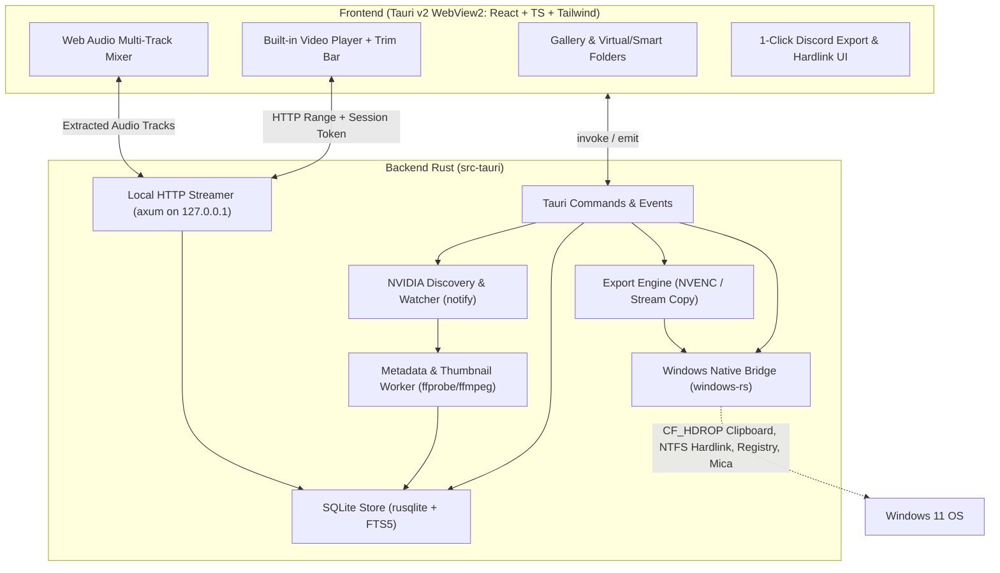

# Glint: Technical & Architecture Specification (v1.0)

Dokumen ini menjadi kontrak teknis utama untuk membangun **Glint**, aplikasi desktop Windows berbasis **Tauri v2 + Rust** untuk mengelola, menonton, mengatur koleksi virtual (seperti folder `Jett Valorant`), memotong, dan mengekspor klip gameplay dengan cepat.

---

## 1. Tujuan, Scope, dan Prinsip Kerja

### 1.1 Masalah yang Diselesaikan
- Software klip pihak ketiga (seperti Medal) berat di background, penuh paywall, dan mewajibkan akun cloud.
- Windows Photos lambat untuk koleksi klip besar dan tidak mendukung multi-track audio atau ekspor pas batas ukuran Discord.
- Memindahkan file klip secara fisik untuk mengelompokkan highlight merusak struktur folder bawaan NVIDIA/OBS/Steam dan menggandakan pemakaian disk.

### 1.2 Prinsip Arsitektur
1. **100% Lokal dan Non-Destruktif:** File video asli tidak pernah dipindah, diubah nama, atau dihapus secara otomatis tanpa aksi eksplisit user.
2. **Virtual-First Organization:** Pengelompokan klip (seperti `Jett Valorant`) disimpan sebagai metadata relasional di SQLite. Satu klip bisa masuk ke banyak koleksi sekaligus tanpa duplikasi byte di disk.
3. **Hardware-Accelerated Export:** Memanfaatkan **NVENC** pada GPU NVIDIA (terverifikasi: RTX 3070 di mesin target) dengan fallback otomatis ke CPU (`libx264`).
4. **Zero-Friction Sharing:** Ekspor 1-klik ke target ukuran Discord (10 MB) langsung menyalin file hasil ke Windows Clipboard (`CF_HDROP`), siap ditempel dengan `Ctrl+V`.

---

## 2. Verifikasi Environment Mesin Target

Berdasarkan pemeriksaan lokal pada mesin pengembangan:

| Komponen | Status | Detail Terverifikasi |
| :--- | :--- | :--- |
| Rust & Cargo | Tersedia | `cargo 1.92.0`, toolchain `stable-x86_64-pc-windows-msvc` di `%USERPROFILE%\.cargo\bin` |
| Node.js & Bun | Tersedia | Node `v24.19.0`, npm, dan Bun (`%USERPROFILE%\.bun\bin\bun.exe`) |
| FFmpeg & ffprobe | Tersedia | FFmpeg `9.0.2-full_build` via WinGet (siap dipakai untuk probe, thumbnail, remux, dan NVENC) |
| GPU | Tersedia | NVIDIA GeForce RTX 3070 (mendukung `h264_nvenc` dan `hevc_nvenc`) |
| NVIDIA ShadowPlay Path | Terverifikasi | Registry `HKCU\Software\NVIDIA Corporation\Global\ShadowPlay\NVSPCAPS\DefaultPathW` terdecode ke `C:\Users\bebas\Videos\NVIDIA` |
| MSVC Build Tools (`link.exe`) | Tersedia | Visual Studio 18 BuildTools (`VC\Tools\MSVC\14.52.37025`, Windows SDK `10.0.26100.0`) terverifikasi siap untuk `x86_64-pc-windows-msvc` |

---

## 3. Arsitektur Sistem



### 3.1 Struktur Direktori Project (Saat Coding Dimulai)
```text
glint/
├── docs/
│   ├── technical-spec.md
│   └── ui-ux-spec.md
├── src/                        # Frontend React + TypeScript + Tailwind
│   ├── app/                    # Layout shell, titlebar custom, state global
│   ├── features/
│   │   ├── library/            # Galeri, filter, virtual & smart folders
│   │   ├── player/             # Video player, timeline, frame-step, Web Audio mixer
│   │   ├── export/             # Trim controls, preset Discord 10MB, progress toast
│   │   └── settings/           # Watch folders, NVIDIA auto-detect, quota cleanup
│   └── lib/                    # Typed Tauri invoke wrapper & keyboard shortcut map
└── src-tauri/                  # Backend Rust
    ├── Cargo.toml
    └── src/
        ├── main.rs
        ├── lib.rs
        ├── db/                 # SQLite migrations, queries, FTS5, smart-folder evaluator
        ├── discovery/          # NVIDIA Registry parser, game normalizer, notify watcher
        ├── media/              # ffprobe metadata, thumbnail cache, waveform extractor
        ├── streamer/           # Local axum HTTP server (Range, MKV remux, audio track split)
        ├── exporter/           # Lossless trim, bitrate calculator, NVENC encoder
        ├── win/                # CF_HDROP clipboard, NTFS hardlink, window-vibrancy Mica
        └── commands/           # Tauri command handlers
```

### 3.2 Pilihan Crate Rust Utama
- `tauri` (v2), `tauri-plugin-dialog`, `tauri-plugin-shell`, `tauri-plugin-opener`
- `window-vibrancy` (efek Windows 11 Mica Light / Acrylic backdrop)
- `axum` + `tokio` + `tokio-util` (Local HTTP Streamer Jalur 1 dengan dukungan HTTP `Range` 206 Partial Content)
- `rusqlite` (dengan fitur `bundled` + `fts5` untuk pencarian cepat)
- `notify` + `notify-debouncer-mini` (pantau klip baru secara real-time setelah tekan hotkey rekam)
- `windows` (`windows-rs` untuk Registry UTF-16LE, `CF_HDROP` Clipboard, dan `CreateHardLinkW`)
- `serde`, `serde_json`, `uuid`, `chrono`, `thiserror`, `tracing`

---

## 4. NVIDIA ShadowPlay / NVIDIA App Discovery (Phase 1)

### 4.1 Auto-Discovery Path
Urutan prioritas deteksi folder klip NVIDIA:
1. Baca Windows Registry:
   - Key: `HKCU\Software\NVIDIA Corporation\Global\ShadowPlay\NVSPCAPS`
   - Value: `DefaultPathW` (tipe `REG_BINARY`, encoding **UTF-16LE** berakhiran null terminator `\0`).
   - Hasil terverifikasi pada mesin target: `C:\Users\bebas\Videos\NVIDIA`.
2. Fallback jika Registry tidak ada: `%USERPROFILE%\Videos\NVIDIA`.
3. User selalu bisa menambah atau menonaktifkan folder bebas (custom folder) dari layar Onboarding atau Settings.

### 4.2 Struktur Folder, Normalisasi Nama Game, dan Parsing Metadata
Hasil observasi folder NVIDIA lokal menunjukkan pola berikut:
- Setiap subfolder level-1 di bawah root NVIDIA mewakili nama game/aplikasi (contoh: `Valorant`, `Counter-strike 2`, `Marvel Rivals`, `Overwatch 2`, `Desktop`).
- Terdapat variasi penamaan folder yang tidak rapi (contoh: spasi ganda seperti `Wang Pai Dui Jue   Lost Saga` vs `Wang Pai Dui Jue Lost Saga`, atau nama executable seperti `PenguinHotel-Win64-Shipping`).
- **Aturan Normalisasi:**
  - Collapse spasi ganda menjadi satu spasi dan trim whitespace.
  - Simpan `raw_folder_name` tetap utuh, lalu petakan ke `games.display_name` yang bisa digabung/diubah namanya oleh user (alias mapping) tanpa mengubah nama folder asli di disk.
- **Pola Nama File ShadowPlay:**
  - Contoh nyata: `Desktop 2024.12.26 - 14.12.05.01.mp4` atau `Valorant 2026.11.24 - 21.15.30.05.DVR.mp4`.
  - Timestamp rekaman diambil dari urutan prioritas: (1) regex nama file `YYYY.MM.DD - HH.MM.SS`, (2) metadata container `format.tags.creation_time`, (3) filesystem `modified_time`.
- **Metadata Audio Track:**
  - `ffprobe` membaca label bawaan NVIDIA pada `stream.tags.name` (terverifikasi: `"System sounds"`, dan `"Microphone"` jika mode separate tracks aktif). Jika kosong, fallback ke `"Audio Track 1"`, `"Audio Track 2"`, dst.

---

## 5. Video Player & Local Streamer Architecture (Jalur 1)

Jalur 1 menggunakan server HTTP lokal berbasis `axum` di Rust yang diikat khusus ke loopback `127.0.0.1:0` (ephemeral port acak saat startup) dengan **session token acak 256-bit** (wajib dikirim via query/header agar proses lokal lain tidak bisa mengakses media sembarangan).

### 5.1 Endpoint Local Streamer
| Endpoint | Fungsi | Perilaku Teknis |
| :--- | :--- | :--- |
| `GET /video/:clip_id?token=...` | Streaming video utama ke `<video>` | Untuk `.mp4` (H.264/AAC), langsung layani file asli dengan **HTTP 206 Partial Content** (zero-copy seeking instan). Untuk `.mkv` atau container non-WebView, lakukan **on-the-fly remux** ke fragmented MP4 (`ffmpeg -i input -c:v copy -an -movflags frag_keyframe+empty_moov -f mp4 pipe:1`). |
| `GET /audio/:clip_id/:track_index?token=...` | Streaming 1 track audio terpisah | Jika klip memiliki `audio_track_count > 1`, ekstrak dan cache ringan track audio per index (`aac`/`opus` dalam container `.m4a`/`.webm` di folder cache lokal) agar Web Audio API dapat memutar semua track secara sinkron dengan kontrol mute/volume independen. |
| `GET /thumb/:clip_id?token=...` | Thumbnail kartu galeri | Generate 1 frame WebP (`480px` lebar) pada detik 20% durasi klip dan simpan di `%LOCALAPPDATA%\Glint\cache\thumbs\`. |
| `GET /waveform/:clip_id/:track_index?token=...` | Data puncak amplitudo audio | Kembalikan array JSON ringan (misal 200 sample puncak normalisasi `0.0..1.0`) untuk menggambar gelombang audio di trim bar. |

### 5.2 Sinkronisasi Multi-Track Audio di Player
- **Klip 1 Audio Track (mayoritas ShadowPlay standar):** Putar langsung lewat elemen `<video>` bawaan (latensi 0, CPU minimal).
- **Klip Multi-Track (`>= 2` track, misal Game + Mic/Discord):**
  - Mute elemen `<video>` utama (hanya render gambar video).
  - Muat tiap track audio ke `AudioContext` (Web Audio API) masing-masing melalui `GainNode` terpisah (user bisa mute/unmute & geser volume per track secara real-time saat video berjalan).
  - Sync loop mengecek drift antara `video.currentTime` dan audio playback tiap 250ms; jika drift > 45ms, lakukan resync halus.
  - Mendukung playback rate `0.25x` sampai `2.0x` secara sinkron antara video dan semua track audio.

### 5.3 Kontrol Player & Playlist
- **Playlist Auto-Next:** Ketika membuka klip dari suatu game atau Virtual Folder (contoh: `Jett Valorant`), player membawa konteks urutan klip di koleksi tersebut untuk tombol Next/Prev dan auto-advance.
- **Frame-by-Frame Stepping:** Menggunakan `fps` asli klip dari `ffprobe` (`1 / fps` detik per tekan tombol `,` atau `.` saat pause).

---

## 6. Skema Database SQLite (`%LOCALAPPDATA%\Glint\glint.db`)

Mode SQLite: `WAL` (Write-Ahead Logging), `foreign_keys = ON`, `synchronous = NORMAL`.

```sql
CREATE TABLE watch_folders (
    id TEXT PRIMARY KEY,
    path TEXT NOT NULL UNIQUE,
    source_type TEXT NOT NULL CHECK (source_type IN ('nvidia', 'obs', 'steam', 'custom')),
    enabled INTEGER NOT NULL DEFAULT 1,
    last_scanned_at TEXT
);

CREATE TABLE games (
    id TEXT PRIMARY KEY,
    raw_name TEXT NOT NULL UNIQUE,
    display_name TEXT NOT NULL,
    alias_group_id TEXT,
    cover_color TEXT
);

CREATE TABLE clips (
    id TEXT PRIMARY KEY,
    file_path TEXT NOT NULL UNIQUE,
    file_name TEXT NOT NULL,
    file_size_bytes INTEGER NOT NULL,
    file_mtime INTEGER NOT NULL,
    source_type TEXT NOT NULL,
    game_id TEXT REFERENCES games(id) ON DELETE SET NULL,
    recorded_at TEXT NOT NULL,
    duration_sec REAL NOT NULL,
    width INTEGER NOT NULL,
    height INTEGER NOT NULL,
    fps REAL NOT NULL,
    video_codec TEXT NOT NULL,
    audio_track_count INTEGER NOT NULL DEFAULT 1,
    is_favorite INTEGER NOT NULL DEFAULT 0,
    is_pinned INTEGER NOT NULL DEFAULT 0, -- Kebal dari auto-cleanup
    title TEXT,                           -- Judul kustom opsional, misal "Jett 4K Ascent"
    notes TEXT,
    thumb_path TEXT,
    is_missing INTEGER NOT NULL DEFAULT 0, -- 1 jika file dihapus di luar app
    indexed_at TEXT NOT NULL
);

CREATE TABLE audio_tracks (
    id TEXT PRIMARY KEY,
    clip_id TEXT NOT NULL REFERENCES clips(id) ON DELETE CASCADE,
    stream_index INTEGER NOT NULL,
    track_order INTEGER NOT NULL,
    label TEXT NOT NULL,                  -- Contoh: "System sounds", "Microphone"
    codec TEXT NOT NULL,
    channels INTEGER NOT NULL,
    sample_rate INTEGER NOT NULL,
    bitrate INTEGER
);

-- Virtual Folder (Manual Collection & Smart Folder)
CREATE TABLE collections (
    id TEXT PRIMARY KEY,
    name TEXT NOT NULL,                   -- Contoh: "Jett Valorant"
    kind TEXT NOT NULL CHECK (kind IN ('manual', 'smart')),
    icon TEXT,
    color TEXT,
    smart_rules_json TEXT,                -- NULL untuk manual; JSON AST untuk smart folder
    sort_order INTEGER NOT NULL DEFAULT 0,
    created_at TEXT NOT NULL,
    updated_at TEXT NOT NULL
);

CREATE TABLE collection_clips (
    collection_id TEXT NOT NULL REFERENCES collections(id) ON DELETE CASCADE,
    clip_id TEXT NOT NULL REFERENCES clips(id) ON DELETE CASCADE,
    added_at TEXT NOT NULL,
    position INTEGER NOT NULL DEFAULT 0,
    PRIMARY KEY (collection_id, clip_id)
);

CREATE TABLE tags (
    id TEXT PRIMARY KEY,
    name TEXT NOT NULL UNIQUE COLLATE NOCASE,
    color TEXT
);

CREATE TABLE clip_tags (
    clip_id TEXT NOT NULL REFERENCES clips(id) ON DELETE CASCADE,
    tag_id TEXT NOT NULL REFERENCES tags(id) ON DELETE CASCADE,
    PRIMARY KEY (clip_id, tag_id)
);

CREATE TABLE export_jobs (
    id TEXT PRIMARY KEY,
    clip_id TEXT NOT NULL REFERENCES clips(id) ON DELETE CASCADE,
    preset TEXT NOT NULL,                 -- 'discord_10mb', 'discord_25mb', 'lossless_trim', 'custom'
    start_sec REAL NOT NULL,
    end_sec REAL NOT NULL,
    output_path TEXT NOT NULL,
    output_size_bytes INTEGER,
    encoder_used TEXT,                    -- 'h264_nvenc', 'libx264', 'copy'
    status TEXT NOT NULL CHECK (status IN ('queued', 'running', 'done', 'failed', 'cancelled')),
    error_message TEXT,
    created_at TEXT NOT NULL,
    finished_at TEXT
);

CREATE TABLE app_settings (
    key TEXT PRIMARY KEY,
    value_json TEXT NOT NULL
);

-- Indeks untuk query galeri & pencarian cepat
CREATE INDEX idx_clips_game_recorded ON clips(game_id, recorded_at DESC);
CREATE INDEX idx_clips_favorite ON clips(is_favorite) WHERE is_favorite = 1;
CREATE INDEX idx_clips_missing ON clips(is_missing);
CREATE INDEX idx_collection_clips_col ON collection_clips(collection_id, position);

-- Full-Text Search untuk judul, nama file, catatan, dan nama game
CREATE VIRTUAL TABLE clips_fts USING fts5(
    clip_id UNINDEXED,
    title,
    file_name,
    notes,
    game_name,
    tags_text
);
```

---

## 7. Virtual Folder, Smart Folder, & NTFS Hardlink Export

### 7.1 Manual Collection (Generik; Contoh Ilustrasi: "Jett Valorant")
- Koleksi sepenuhnya generik untuk game atau kategori apa pun. Pada instalasi baru, tabel `collections` dimulai kosong (tidak ada folder game/agent bawaan yang di-hardcode; `"Jett Valorant"` di dokumen ini hanya contoh penggunaan).
- User membuat koleksi bebas (`kind = 'manual'`), lalu menambahkan klip lewat drag-and-drop, tombol `+`, atau klik kanan (hanya menyisipkan baris ke `collection_clips`).
- Menghapus klip dari koleksi hanya menghapus baris relasi di `collection_clips`, **tidak pernah** menghapus file video di disk.

### 7.2 Smart Folder (Rule Engine JSON)
Smart Folder mengevaluasi kondisi secara dinamis ke query SQL yang aman (parameterized):

```json
{
  "match": "all",
  "conditions": [
    { "field": "game", "op": "equals", "value": "Valorant" },
    { "field": "tag", "op": "includes", "value": "jett" },
    { "field": "duration_sec", "op": "lte", "value": 45 }
  ]
}
```

Field yang didukung di Phase 1: `game`, `tag`, `title_or_filename`, `duration_sec`, `is_favorite`, `recorded_within_days`.

### 7.3 "Open as Real Folder" (NTFS Hardlink Bridge)
Ketika user ingin mengedit isi koleksi `Jett Valorant` di Premiere Pro / CapCut / DaVinci Resolve:
1. Default target: `%LOCALAPPDATA%\Glint\linked-folders\<slug-koleksi>\` (atau folder custom di drive yang sama).
2. Untuk setiap klip dalam koleksi:
   - Cek apakah root volume file sumber sama dengan volume target (contoh: sama-sama `C:\` dan filesystem NTFS).
   - **Jika sama-sama NTFS di drive yang sama:** Panggil Win32 `CreateHardLinkW` via `windows-rs`. File muncul secara nyata di Windows Explorer dengan **0 byte ruang disk tambahan**.
   - **Jika beda drive (misal sumber di `D:\`, target di `C:\`):** Tawarkan opsi buat folder link di drive `D:\` (agar tetap 0 byte via hardlink) atau salin fisik (copy) dengan konfirmasi ukuran total sebelum dieksekusi.
3. Setelah selesai, buka folder tersebut langsung di Windows Explorer (`explorer.exe`).

---

## 8. Export Engine, NVENC, dan 1-Klik Discord Clipboard

### 8.1 Kalkulator Target Ukuran (10 MB / 25 MB / 50 MB)
Untuk preset `discord_10mb`:
- Target efektif: `9.5 MB` (margin aman 5% untuk overhead container MP4 agar tidak ditolak Discord).
- Durasi klip hasil trim: `D = end_sec - start_sec` (minimal `0.5` detik).
- Budget audio: `A_kbps` = `128 kbps` (atau `96 kbps` jika `D > 45s`, atau `0` jika semua track di-mute).
- Budget video:
  `V_kbps = floor((9.5 * 8192) / D) - A_kbps`
- Guardrails kualitas otomatis:
  - Jika `V_kbps < 1200` (klip panjang, misal > 55 detik) dan resolusi asli 1080p: otomatis downscale ke `720p` (`-vf scale=-2:720`) agar gambar tetap tajam dan tidak pecah.
  - Jika `V_kbps < 600` (klip terlalu panjang untuk 10 MB): tampilkan peringatan ringan di UI menyarankan trim lebih pendek atau preset 25 MB.

### 8.2 Pipeline FFmpeg & Mix Multi-Track Audio
- **Lossless Trim (`preset = lossless_trim`)** saat tidak mengubah mix audio:
  `ffmpeg -ss <start> -to <end> -i <input> -c copy -movflags +faststart <out.mp4>`
- **Discord Target Size (NVENC RTX 3070 + Multi-Track Filter):**
  - Jika user mengaktifkan lebih dari 1 track audio (misal Game 100% + Mic 60%), bangun filter FFmpeg `amix` + `volume` sesuai setting mixer di player.
  - Encoder video: `-c:v h264_nvenc -preset p4 -rc vbr -b:v <V_kbps>k -maxrate <V_kbps*1.25>k -bufsize <V_kbps*2>k -pix_fmt yuv420p -movflags +faststart`.
  - Jika `h264_nvenc` gagal diinisialisasi (misal PC non-NVIDIA atau driver bermasalah), fallback otomatis ke `-c:v libx264 -preset fast`.
- **Progress Real-Time:** Baca output `-progress pipe:1` dari FFmpeg untuk memancarkan event `export:progress` (`0..100%`, ETA) ke frontend.

### 8.3 Auto Copy File ke Windows Clipboard (`CF_HDROP`)
Setelah file ekspor selesai dibuat:
- Panggil Win32 API via `windows-rs`: `OpenClipboard` -> `EmptyClipboard` -> alokasikan `GlobalAlloc(GMEM_MOVEABLE)` berisi struct `DROPFILES` (`fWide = TRUE`) diikuti path file UTF-16LE berakhiran double-null -> `SetClipboardData(CF_HDROP, hmem)` -> `CloseClipboard`.
- User tinggal tekan `Ctrl+V` di Discord, WhatsApp Desktop, atau Telegram untuk langsung mengunggah video tersebut.

---

## 9. Kontrak IPC (Tauri Commands & Events)

### 9.1 Commands (`invoke`)
| Command | Input Ringkas | Output Ringkas |
| :--- | :--- | :--- |
| `get_bootstrap_state` | none | `{ streamerBaseUrl, streamerToken, watchFolders, hasNvenc, stats }` |
| `detect_nvidia_folder` | none | `{ found, path, source: 'registry' \| 'default' }` |
| `add_watch_folder` | `{ path, sourceType }` | `WatchFolder` |
| `scan_watch_folders` | `{ folderId?: string }` | `{ queuedCount }` (progres dikirim via event) |
| `list_clips` | `{ gameId?, collectionId?, tagIds?, search?, favoritesOnly?, sortBy?, limit, offset }` | `{ items: ClipSummary[], total }` |
| `get_clip_detail` | `{ clipId }` | `{ clip, audioTracks, tags, collectionIds }` |
| `update_clip_meta` | `{ clipId, title?, notes?, isFavorite?, isPinned?, tagNames? }` | `ClipDetail` |
| `list_collections` | none | `CollectionSummary[]` (termasuk jumlah klip per koleksi) |
| `create_collection` | `{ name, kind, icon?, color?, smartRulesJson? }` | `CollectionSummary` |
| `update_collection` | `{ id, name?, icon?, color?, smartRulesJson? }` | `CollectionSummary` |
| `delete_collection` | `{ id }` | `{ ok: true }` (hanya hapus koleksi virtual, bukan file) |
| `modify_collection_clips` | `{ collectionId, addClipIds?, removeClipIds? }` | `{ count }` |
| `export_collection_hardlinks` | `{ collectionId, targetDir? }` | `{ folderPath, linkedCount, skippedCount, crossDriveWarning? }` |
| `start_export` | `{ clipId, preset, startSec, endSec, audioMix: AudioTrackMix[], copyToClipboard: bool }` | `{ jobId }` |
| `cancel_export` | `{ jobId }` | `{ ok: true }` |
| `copy_file_to_clipboard` | `{ filePath }` | `{ ok: true }` |
| `open_in_explorer` | `{ filePath }` | `{ ok: true }` |
| `get_storage_cleanup_preview` | `{ maxGb: number }` | `{ totalGb, candidates: ClipSummary[], reclaimableGb }` |
| `run_storage_cleanup` | `{ clipIds: string[], moveToRecycleBin: true }` | `{ removedCount, freedBytes }` (default ke Recycle Bin Windows, bukan hapus permanen) |

### 9.2 Events (`emit`)
- `scan:progress` -> `{ scanned, total, currentFile }`
- `clip:added` / `clip:removed` -> sinkronisasi otomatis saat watcher mendeteksi klip baru
- `export:progress` -> `{ jobId, percent, etaSec, speed }`
- `export:completed` -> `{ jobId, outputPath, outputSizeBytes, copiedToClipboard }`
- `export:failed` -> `{ jobId, error }`

---

## 10. Keamanan, Privasi, & Keandalan

- **Loopback Isolation:** Server `axum` hanya bind ke `127.0.0.1`, menolak request tanpa `token` sesi yang cocok, dan hanya mengizinkan akses terhadap `clip_id` yang terdaftar di SQLite (mencegah path traversal sembarangan).
- **Safe Delete:** Fitur auto-cleanup atau hapus klip dari app secara default memindahkan file ke **Windows Recycle Bin** (bukan permanent delete), dan secara keras mengecualikan klip dengan `is_favorite = 1` atau `is_pinned = 1`.
- **Resilience File Hilang:** Jika user menghapus atau memindahkan file video langsung dari Windows Explorer, watcher menandai `is_missing = 1` tanpa menghancurkan catatan koleksi/tag hingga user memilih membersihkan item yang hilang.

---

## 11. Roadmap Implementasi & Definition of Done

### Phase 1: Foundation, NVIDIA Scanner & Light Glass Gallery
- Verifikasi linker MSVC & inisialisasi workspace Tauri v2 + `window-vibrancy` (Mica Light).
- Auto-detect folder NVIDIA (`DefaultPathW` + fallback), SQLite schema + FTS5, `ffprobe` indexer, thumbnail WebP cache, dan real-time `notify` watcher.
- UI galeri Light Glassmorphism terkelompok per game + pencarian cepat + Virtual Folder manual (misal `Jett Valorant`) dan Smart Folder.
- **Done jika:** Folder NVIDIA lokal terbaca otomatis, galeri tampil lancar dengan thumbnail, dan user bisa membuat folder `Jett Valorant` lalu memasukkan klip tanpa memindahkan file asli.

### Phase 2: Built-in Video Player & Multi-Track Audio Mixer
- Local HTTP Streamer (`axum`) dengan Range 206 + session token + audio track extractor.
- Player layar penuh dengan playlist auto-next per koleksi, shortcut (`Spasi`, `J/L`, `,`/`.`, speed `0.25x..2x`), dan Live Multi-Track Audio Mixer.
- **Done jika:** Klip NVIDIA (termasuk multi-track jika ada) dapat diputar mulus, seek instan, frame-step akurat, dan playlist folder berjalan berurutan.

### Phase 3: Quick Trim, 1-Klik Discord 10MB (NVENC), & Hardlink Bridge
- Trim scrubber dengan estimasi ukuran, pipeline `h264_nvenc` target 10MB/25MB + lossless trim, dan `CF_HDROP` auto-copy ke Clipboard Windows.
- Tombol "Open as Real Folder" berbasis `CreateHardLinkW` + preview storage cleanup (ke Recycle Bin).
- **Done jika:** Trim + ekspor 10MB selesai dalam hitungan detik di RTX 3070, ukuran akhir <= 10 MB, dan langsung bisa `Ctrl+V` di Discord.

### Phase 4: Ekspansi Sumber (OBS MKV & Steam Game Recording)
- Auto-detect OBS config + on-the-fly MKV remux.
- Parser Steam Game Recording (fragmen DASH `.m4s` + `session.mpd` + marker timeline).
